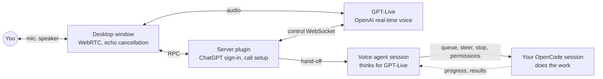

# opencode-live

**Talk to OpenCode Desktop out loud.** Real-time voice calls with your OpenCode session, on your ChatGPT subscription.
You talk; GPT-Live, OpenAI's real-time voice model, answers as you speak, hands the real work to the session on your
screen, and tells you how it went.

> Based on [opencode-gpt-live](https://github.com/malhashemi/opencode-gpt-live) by
> [M. Adel Alhashemi](https://github.com/malhashemi), which built the GPT-Live connection, the ChatGPT sign-in and the
> voice agent that drives your session. This fork is **OpenCode Desktop only**: the call runs in the app window, and it
> adds a desktop call panel, a voice agent view, better call context, waiting for you to finish talking, voice settings
> and an on-device wake word. For the terminal (TUI), use the original.

[](https://github.com/devagrawal09/opencode-live/actions/workflows/ci.yml)
[](LICENSE)


[Install](#install) · [Usage](#usage) · [Configuration](#configuration) · [How it works](#how-it-works) ·
[Privacy](#privacy) · [Troubleshooting](#troubleshooting)

---

## What you get

- **Talk while it works.** Requests go to your session as tasks. Ask "how's it going?", change direction mid-task, or
  say "stop that". Approve permission prompts by voice.
- **It knows the context.** Each call starts with your session's recent history and your earlier voice calls, so "what
  were we just doing?" gets an answer straight away.
- **It waits for you.** Results that arrive while you (or GPT-Live) are talking are held and spoken once you're done,
  permission prompts first.
- **See everything.** The call panel shows the transcript and, side by side, what the voice agent did for each request:
  tools, reply and timings. An optional debug view lists GPT-Live's raw events.
- **Pick a voice.** 26 voices and a speaking-pace hint, from the panel or **Settings › GPT-Live**.
- **"Hey Jarvis" (experimental).** An on-device wake word starts a call hands-free; nothing is sent until you say it.
- **No API key.** It uses the ChatGPT sign-in you already have in OpenCode.

## Requirements

- [OpenCode Desktop](https://opencode.ai) 2.3 or newer. Tested on macOS (Apple silicon).
- A **ChatGPT Plus or Pro** plan, connected in OpenCode with **`/connect` › OpenAI › "Codex browser (legacy)"**.
  - ChatGPT Go doesn't include voice through Codex: calls fail with a 404.
  - The newer "Sign in with ChatGPT" login only covers text requests and hides the account ID GPT-Live needs.
- A microphone and speakers (headphones work best).
- [Bun](https://bun.sh) to build the plugin.

## Install

The plugin isn't on npm. Build it from a clone:

```sh
git clone https://github.com/devagrawal09/opencode-live
cd opencode-live
bun install
bun run build:gui
```

Add it to `~/.config/opencode/opencode.json` (OpenCode Desktop reads plugins only from the global config):

```jsonc
{
  "$schema": "https://opencode.ai/config.json",
  "plugins": [
    { "package": "/path/to/opencode-live", "options": { "voiceModel": "openai/gpt-6-luna", "voiceVariant": "low" } },
  ],
}
```

Restart OpenCode Desktop. The first call asks macOS for microphone access for OpenCode.

## Usage

1. Open a session and run `/voice`, or press <kbd>⌘</kbd><kbd>⌥</kbd><kbd>V</kbd>.
2. Talk. For example: "What does this project do?" · "Add a dark mode toggle, then run the tests." · "How's it going?" ·
   "Actually, use the existing theme hook." · "Stop that."
3. Hang up by saying "end the call", or with `/voice` / <kbd>⌘</kbd><kbd>⌥</kbd><kbd>V</kbd> again.

| Command                       | Key                                  | What it does                                            |
| ----------------------------- | ------------------------------------ | ------------------------------------------------------- |
| `/voice`                      | <kbd>⌘</kbd><kbd>⌥</kbd><kbd>V</kbd> | Start or end a call on the current session              |
| Mute voice call               | <kbd>⌘</kbd><kbd>⌥</kbd><kbd>M</kbd> | Mute or unmute your microphone                          |
| `/voice-new`                  |                                      | Start a call in a fresh voice conversation              |
| `/voice-pick`                 |                                      | Open **Settings › GPT-Live**: voice and speaking pace   |
| Show voice call panel         |                                      | The call panel (also in the side panel's **+** menu)    |
| Show GPT-Live events          |                                      | Toggle the debug view of GPT-Live's events in the panel |
| Start listening for wake word |                                      | Toggle the "Hey Jarvis" wake word                       |

Every command is in the command palette (<kbd>⌘</kbd><kbd>P</kbd>). Change the keys in **Settings › Shortcuts**.

**The call panel** has the call controls, mic and speaker levels and, when no call is up, the voice and pace pickers.
Below them, the transcript and the **Voice agent** column sit side by side; collapse the column to a thin rail with its
header. Earlier calls stay in the transcript, under a divider. A pill above the composer shows the call state.

### Wake word (experimental)

Run **Start listening for wake word**, then say "Hey Jarvis": a chime plays, a call connects (GPT-Live skips its
greeting), and you say what you want. Wait for the chime: words said in the same breath as the wake word aren't
captured. A wake-word call hangs up after about 20 seconds with no talking, no queued tasks and nothing working, and
listening resumes.

- Detection runs in the app window with [LiveKit WakeWord](https://github.com/livekit/livekit-wakeword)'s "hey jarvis"
  model on ONNX Runtime. The first time, the app downloads the model (7 MB, LiveKit's GitHub release) and ONNX Runtime's
  WebAssembly (15 MB, jsDelivr), checks both against pinned SHA-256 digests, and caches them.
- The microphone stays open while listening, so macOS shows its orange dot. One window listens at a time, and it has to
  stay open (minimised is fine).
- False wakes happen (about 0.5 to 2.5 an hour on conversational speech): they start a short call that hangs up on its
  own.

## Configuration

Options go in the plugin entry's `options`. All are optional.

| Option                   | Default                | Description                                                                                             |
| ------------------------ | ---------------------- | ------------------------------------------------------------------------------------------------------- |
| `voice`                  | `"cove"`               | GPT-Live's voice. The panel and **Settings › GPT-Live** override it. See [Voices](#voices).             |
| `pace`                   | `"normal"`             | Speaking-pace hint: `normal`, `slower` or `faster`. One sentence in GPT-Live's prompt, not a speed.     |
| `voiceModel`             | `"openai/gpt-6.1-sol"` | Model for the voice agent, as `provider/model`. A fast model (e.g. `openai/gpt-6-luna`) feels snappier. |
| `voiceVariant`           | `"medium"`             | Thinking level for that model.                                                                          |
| `instructions`           |                        | Extra instructions for GPT-Live, such as a language or tone.                                            |
| `voiceAgentInstructions` |                        | Extra instructions for the voice agent.                                                                 |
| `prompts`                |                        | Replace a built-in prompt: `{ "gptLive": "<path>", "voiceAgent": "<path>" }`. See below.                |
| `log`                    | `true`                 | Keep a local log of each call (see [Privacy](#privacy)).                                                |

Use a voice-agent model from a provider that runs OpenCode's own tool loop, such as `openai/*`. Providers that drive
their own agent (such as `claude-agent/*`) may not get the voice agent's prompt or tools.

### Voices

`cove`, `juniper`, `maple`, `spruce`, `ember`, `vale`, `breeze`, `arbor`, `sol`, `marin`, `aube`, `bubbie`, `haetsal`,
`hanul`, `himari`, `leher`, `miko`, `neer`, `porto`, `rindo`, `rio`, `rivage`, `selva`, `sonna`, `tinta` and `viola`.
A call's voice and pace are set when it starts; changes apply to the next call.

### Custom prompts

A call uses two prompts, both folders of Markdown sections in [`src/server/prompts/`](src/server/prompts): one for
GPT-Live, which talks, and one for the voice agent, which acts for it. Copy one, edit it, and point the plugin at it:

```jsonc
{
  "options": {
    "prompts": { "gptLive": "~/.config/opencode/voice/gpt-live", "voiceAgent": ".opencode/voice-agent.md" },
  },
}
```

Relative paths resolve against the project and `~` expands. `{{project}}` and `{{directory}}` are filled in. Prompts are
read at the start of each call.

## How it works



- **The desktop window** owns the audio: microphone, speaker and the WebRTC connection to OpenAI, with Chromium's echo
  cancellation and noise suppression. It never sees your credentials.
- **The server plugin** holds your ChatGPT credentials, creates the call with its context, joins its control channel
  and bridges GPT-Live to OpenCode. It holds spoken results while someone is talking.
- **The voice agent** is a separate OpenCode session per coding session. GPT-Live hands it anything that needs thinking
  or acting. It can only talk to your main session (queue or steer work, check on it, read what it did, stop it, answer
  its permission prompts); it can't read files or run commands.
- **Your main session** does the actual work, as if you had typed the request.

The [architecture guide](docs/architecture.md) has the details.

## Privacy

- Audio goes directly between your computer and OpenAI over encrypted WebRTC, under your ChatGPT account and OpenAI's
  terms.
- Your ChatGPT credentials stay in OpenCode; the plugin reads them from OpenCode's sign-in.
- Each call writes a local log of transcripts and events to `~/.local/state/opencode-gpt-live/calls/`
  (`$XDG_STATE_HOME` if set). Set `"log": false` to turn it off.
- The voice conversation is an ordinary OpenCode session, stored like any other.
- With the wake word on, the microphone is open and listened to on your Mac only; nothing leaves it until you say the
  wake word.

## Troubleshooting

| Symptom                                              | Fix                                                                                  |
| ---------------------------------------------------- | ------------------------------------------------------------------------------------ |
| "GPT-Live needs your ChatGPT subscription", or a 401 | `/connect` › OpenAI › "Codex browser (legacy)".                                      |
| "…sign-in has no account ID"                         | You're on the "Sign in with ChatGPT" login. Reconnect with "Codex browser (legacy)". |
| 404 when the call starts                             | Your plan doesn't include Codex voice (ChatGPT Go). Plus or Pro does.                |
| 403 or 429 when the call starts                      | Voice isn't on your plan, or the voice allowance is used up.                         |
| GPT-Live can't hear you                              | System Settings › Privacy & Security › Microphone › allow OpenCode.                  |
| Plugin changes don't show up                         | `opencode service restart`; see [development](docs/development.md).                  |

## Development

```sh
bun install
bun run check      # formatting, lint, types, tests
bun run dev:gui    # rebuild the desktop bundle on changes
```

See [CONTRIBUTING.md](CONTRIBUTING.md) and the [development guide](docs/development.md).

## Disclaimer

An independent project, not affiliated with or endorsed by OpenAI or the OpenCode team. ChatGPT and GPT-Live are
trademarks of OpenAI. The plugin uses the voice service that comes with a ChatGPT subscription through an undocumented
Codex endpoint, which OpenAI may change or block at any time.

## License

[MIT](LICENSE). © M. Adel Alhashemi (original [opencode-gpt-live](https://github.com/malhashemi/opencode-gpt-live)) and
Dev Agrawal (desktop fork). Third-party notices are in [NOTICE](NOTICE).
