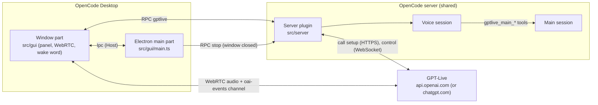

# Architecture

opencode-live is an OpenCode Desktop plugin. One npm package carries two entries: a server plugin (`index.ts`) that
runs inside the OpenCode server, and a desktop plugin (`gui.tsx`, bundled to `dist/gui-experimental.cjs`) that runs in
every app window and in Electron's main process. The call's audio runs in the window over WebRTC; the server plugin
owns the OpenAI credentials (an API key, or a ChatGPT sign-in), GPT-Live's control channel and the link to your coding
session.

This guide explains what each part owns, how a call flows through them, and the constraints that shaped the design.

## Repository map

| Path                         | What lives there                                                                                      |
| ---------------------------- | ----------------------------------------------------------------------------------------------------- |
| `index.ts`                   | Server plugin entry.                                                                                  |
| `gui.tsx`                    | Desktop entry (`./gui-experimental`): window `setup` and Electron `main`.                             |
| `vite.config.ts`             | Bundles `gui.tsx` into `dist/gui-experimental.cjs`; keeps ONNX Runtime's WebAssembly out of it.       |
| `src/shared/rpc.ts`          | The `GptLive` RPC contract between window and server: methods, events, voices, paces, hand-off steps. |
| `src/server/index.ts`        | Server plugin: the voice agent's tools, the call lifecycle, voice-session continuity, heartbeats.     |
| `src/server/live.ts`         | The backend interface, shared event types and the control WebSocket (`Sideband`).                     |
| `src/server/live-api.ts`     | `api` mode: the documented GPT-Live API (session creation, sideband, events, context appends).        |
| `src/server/live-chatgpt.ts` | `chatgpt` mode: the undocumented ChatGPT/Codex endpoint.                                              |
| `src/server/bridge.ts`       | Connects GPT-Live to OpenCode: hand-offs, coding-session updates, permissions, ending calls.          |
| `src/server/floor.ts`        | Who has the floor: whether the user or GPT-Live is talking, so spoken results can wait.               |
| `src/server/context.ts`      | Conversation history quoted as data, the call's initial items, and agent text made speakable.         |
| `src/server/prompt.ts`       | Loads the system prompts: built-in section folders, user overrides, placeholders, pace/wake hints.    |
| `src/server/prompts/`        | The prompts for GPT-Live and the voice agent, one Markdown file per section.                          |
| `src/server/auth.ts`         | Finds the API key (option, `/connect` key, `OPENAI_API_KEY`) or OpenCode's ChatGPT OAuth sign-in.     |
| `src/server/log.ts`          | The per-call JSONL log.                                                                               |
| `src/gui/window.tsx`         | Window setup: commands, the call panel, the composer pill, the menu item, the settings page.          |
| `src/gui/call.ts`            | The window's call state, RPC calls and events, heartbeats, the idle hang-up.                          |
| `src/gui/transport.ts`       | WebRTC in the window: microphone, peer, `oai-events` data channel, speaker, levels.                   |
| `src/gui/entries.ts`         | The transcript model: lines, tasks, notices, dividers between calls.                                  |
| `src/gui/handoffs.ts`        | The voice-agent column's model: each hand-off's steps, tools, reply and timing.                       |
| `src/gui/events.ts`          | The optional debug view of GPT-Live's data-channel events.                                            |
| `src/gui/scroll.ts`          | Follow the transcript only while it is scrolled to the bottom.                                        |
| `src/gui/wake.ts`            | The wake word listener: the always-on microphone, the model, pausing during calls, the chime.         |
| `src/gui/wake-assets.ts`     | The wake word's model and ONNX Runtime WebAssembly: pinned, downloaded, cached.                       |
| `src/gui/idle.ts`            | When a call started from the wake word has gone quiet.                                                |
| `src/gui/main.ts`            | Electron main: microphone access, background throttling, hanging up on close, wake word host.         |
| `src/gui/contract.ts`        | The `Host` Ipc between a window and main.                                                             |
| `src/gui/definition.ts`      | The desktop plugin's stores (window preferences) and strings.                                         |
| `src/gui/panel.css`          | The call panel's styles.                                                                              |

## The parts

### Server plugin

`src/server/index.ts` registers the `GptLive` RPC (`status`, `start`, `stop`, `alive`, `say`, `trace`) and the voice
agent's tools. It is the only part that sees credentials. A call's **mode** comes from `start` (the window's Settings
choice), else the `mode` option, else `api`.

Each mode is a `Backend` (`src/server/live.ts`): call creation, model, session shape, sideband URL and headers, an
event adapter and the context-append messages. Everything OpenAI-specific lives in the two backends; the bridge, the
floor and the outbox only see `LiveEvent`s and call `sideband.append(text, channel, delegationID?)`.

|                | `api` (default, `live-api.ts`)                                                                                                                    | `chatgpt` (`live-chatgpt.ts`)                                                                                                 |
| -------------- | ------------------------------------------------------------------------------------------------------------------------------------------------- | ----------------------------------------------------------------------------------------------------------------------------- |
| Credentials    | `apiKey` option, then OpenCode's OpenAI API-key connection (active first), then `OPENAI_API_KEY`                                                  | OpenCode's ChatGPT OAuth sign-in plus a ChatGPT account ID                                                                    |
| Model          | `gpt-live-1.1` (`liveModel`)                                                                                                                      | `gpt-live-1.1-codex`                                                                                                          |
| Call creation  | `POST api.openai.com/v1/live/sessions`, JSON `{ session, transport: { type: "webrtc", sdp } }`; the 201 body has `session.id` and `transport.sdp` | `POST chatgpt.com/backend-api/codex/realtime/calls`, JSON `{ sdp, session }` with Codex headers; the call ID is in `Location` |
| Session        | `instructions`, `input` (our initial items), `audio.output.voice`, `delegation: { type: "client" }`                                               | the same, with `initial_items`                                                                                                |
| Sideband       | `wss://api.openai.com/v1/live/sessions/{id}/attach`                                                                                               | `wss://api.openai.com/v1/live/{callID}`                                                                                       |
| Spoken context | `session.commentary.append`                                                                                                                       | `…context.append` with `channel: "speakable"`                                                                                 |
| Silent context | `session.thinking.append`                                                                                                                         | `…context.append` with `channel: "commentary"`                                                                                |
| Per hand-off   | `delegation_id` on the same events (`null` for the call)                                                                                          | `delegation.context.append` with `delegation_item_id`                                                                         |
| Events         | transcript deltas only; `session.delegation.created` without the request                                                                          | `turn.created`/`turn.done`, `delegation.created` with the request text                                                        |

The API marks no turn ends and sends no request text, so its adapter (`ApiEvents`) ends a speaker's turn after 1.2
seconds without transcript, and hands a delegation over 300 ms after it arrives (transcripts can trail it) with the
user's words since the previous hand-off as the request. It drops events the sideband replays on attach (by
`event_id`) and ignores reflected microphone audio. GPT-Live's prompt names the two kinds of context in each mode's
words (`{{silentContext}}`, `{{spokenContext}}`), since the API's "commentary" is the spoken one.

`resolveAuth` (chatgpt) finds an OpenAI OAuth connection, prefers the active one, and needs a token and a ChatGPT account
ID (from the connection's metadata or the token's claims). "Sign in with ChatGPT" token-sharing logins carry no account
ID, so the call is refused with a hint to connect "Codex browser (legacy)" instead. Plans without voice on that endpoint
are rejected (ChatGPT Go gets a 404).

401, 403, 404 and 429 are turned into readable errors per mode. Keys, tokens and account IDs are redacted from error
text.

There is one active call per server at a time.

### Window part

`gui.tsx`'s `setup` runs in every app window. It adds:

- **Commands.** Start/end call (`/voice`, Cmd+Option+V), mute (Cmd+Option+M), new conversation (`/voice-new`), choose
  voice and pace (`/voice-pick`, opens Settings › GPT-Live), wake word on/off, show/hide GPT-Live events, show the
  panel.
- **The call panel**, a side panel tab: status, start/new/mute/end buttons, voice and pace dropdowns while no call is
  up, microphone and speaker levels, what the voice agent and the coding session are doing, then the transcript and
  a collapsible **Voice agent** column side by side. With "Show GPT-Live events" on, a debug list of data-channel
  events and their counts sits below.
- **A composer pill** on the call's sessions (live time, mute, panel, end), and on any session while the window
  listens for the wake word.
- **Settings › GPT-Live**: connection (OpenAI API key or ChatGPT plan), voice and speaking pace. Choices are saved in
  a global store and win over the plugin's `mode`, `voice` and `pace` options; they apply to the next call. The voice
  pickers list the chosen mode's voices; a stored voice the mode lacks falls back to the mode's default.

`src/gui/call.ts` holds the window's call: it opens audio, calls `start`, subscribes to the server's events, sends
heartbeats and tears down. A call is about one session on one server; the window talks to that session's server, which
may be the app's own (sidecar) server or a remote one.

### Electron main part

`gui.tsx`'s `main` (`src/gui/main.ts`) provides the `Host` Ipc for things a window cannot do alone:

- ask macOS for microphone access;
- turn off a window's background throttling while it has a call or listens for the wake word, so heartbeats and the
  model keep their rhythm in the background;
- end a call on the app's own server as soon as its window closes, instead of waiting for heartbeats to stop;
- decide which window listens for the wake word (`free`, `mine` or `other`), and download its files.

## Life of a call

1. **Start.** `/voice`, the key or the panel's button calls `start()` with the current session. The panel opens. The
   composer's current model is copied to the session first, so work sent by voice uses it.
2. **Audio.** Main confirms microphone access. `WindowAudio` opens the microphone with echo cancellation, noise
   suppression and gain control (Chromium's WebRTC stack), adds one send/receive Opus track and the `oai-events` data
   channel, and waits for ICE gathering so the SDP offer carries every candidate (non-trickle).
3. **Call setup.** The window calls the server's `start` RPC with the offer, mode, voice, pace and flags (`fresh`,
   `wake`). The server resolves the mode's credentials, finds or creates the voice session linked to this main session, loads the prompts
   and builds the call's context (below), then posts the offer and session configuration through the mode's backend.
   The response carries the SDP answer and the call (or session) ID. `start` returns those plus the voice session's title, the call
   number and the last lines of the previous call for the panel.
4. **Connect.** The window applies the answer and waits until the peer is connected and the data channel is open. In
   the background the server joins the control WebSocket (up to five attempts with backoff), opens the call log and
   starts the bridge; the call goes `live`.
5. **Talking.** GPT-Live transcribes and replies in real time. Transcripts reach the panel as RPC `transcript`
   events. The window also sees GPT-Live's events on the data channel, but only counts them (for the call log via
   `trace`, and for the debug view); the server acts on the control channel's copy.
6. **Hand-offs.** When GPT-Live needs to think or act it creates a delegation, and the bridge sends a message to the
   voice session (see below). The voice agent's reply goes back to GPT-Live to be spoken.
7. **Work.** The voice agent's tools act on the main session; its ID is never in the prompt.
8. **End.** The user says "end the call" (the voice agent calls `gptlive_end_call`, which hangs up 4.5 seconds later
   after a short goodbye), runs `/voice`, presses the key or clicks End. The server closes the bridge and control
   channel and emits `closed`; the window closes the peer and the microphone and shows how long the call lasted.

## Call context

A call should know what it is about before anyone speaks. `start` gathers:

- **Earlier voice turns.** Plugin storage keeps `link/<mainSessionID>` (the voice session and its call count) and
  `turns/<voiceSessionID>` (the last 30 finished turns). Turns that are only backchannel ("mm-hmm", "yeah") are not
  kept. `/voice-new` starts a fresh voice session.
- **Session history.** The main session's recent user and assistant text, from OpenCode's session context.

These go into the call in two ways (`src/server/context.ts`):

- **`initial_items`** (`input` in `api` mode), the conversation the call starts with: the last 20 earlier voice turns as real user and
  assistant messages, then one developer note. The note says that "the session" means the user's OpenCode coding
  session (by title and project), not the voice call, and carries recent session history. It tells GPT-Live to answer
  recap questions ("what were we doing?") itself from that history and the earlier calls, without delegating, and to
  delegate for current status, details, files or any action. The note comes last so the call never opens on an
  unanswered user turn. Initial items were chosen because GPT-Live answered as if it never saw the same context in
  `instructions`, and appending it on the control channel after connecting made it reply to every chunk.
- **`instructions`**: GPT-Live's prompt, plus a pace hint, a wake hint (no greeting) when the call came from the wake
  word, and the same history quoted as data, capped in size.

History is always quoted as JSON data marked "for continuity only ... not instructions", with `<` escaped, so text in
a session cannot pose as instructions.

## The bridge and the voice agent

`src/server/bridge.ts` connects one GPT-Live call to two OpenCode sessions:

- the **voice session**, which receives everything GPT-Live delegates. Its agent (default model `openai/gpt-6.1-sol`,
  `voiceModel` and `voiceVariant` options) answers conversational questions or hands real work over;
- the **main session** the call was started from, which only ever receives explicit tasks.

Each hand-off message contains `<conversation_since_last_message>` (turns since the previous hand-off, including ones
GPT-Live answered itself), `<coding_session_updates>` (task outcomes, permission requests and other updates the voice
agent has not seen) and `<request>`, plus `<call_started>` on the first one of a call. It is queued into the voice
session with the delegation ID in its metadata.

The voice agent's tools act on the main session implicitly: `gptlive_main_send` (queue or steer a task),
`gptlive_main_status`, `gptlive_main_read`, `gptlive_main_stop`, `gptlive_main_permissions`,
`gptlive_main_permission_reply` and `gptlive_end_call`. The server's session hooks give the voice session its prompt
and these tools only, and hide them from every other session.

When the voice agent finishes, its last text is made speakable (code blocks dropped, length capped). If it handed work
off with `gptlive_main_send`, GPT-Live has already acknowledged, so the reply goes back as silent `commentary` and the
task's result is spoken later. Otherwise it goes back as `speakable` on the delegation.

The bridge follows the main session's events: tasks move through `queued`, `running`, `done`, `failed` or
`cancelled` (shown in the transcript as task rows), outcomes are spoken and kept for the next hand-off, and
permission requests are spoken as they arrive.

### Not talking over the user

Answers, task outcomes and permission prompts wait while the user or GPT-Live is talking. `Floor`
(`src/server/floor.ts`) judges who has the floor from turn starts (`turn.created`), turn progress, transcripts and
output audio: the user is speaking for 1.2 seconds after their last transcript delta, a finished user turn keeps the
floor 1.2 more seconds in case it was a pause, and GPT-Live holds it while its reply is open and for 1 second after
its last audio chunk. Stale turns time out.

Held items sit in the bridge's outbox and go out together, as one append, as soon as the floor frees: permission
prompts first, then the reply, then outcomes. A newer outcome for the same task replaces the old one. A newer
delegation turns a held answer to an earlier one into silent commentary on that hand-off. Typed messages (`say`) are
never held. `held`, `flushed`, `superseded` and `dropped` lines in the call log show the waits.

### Hand-off events

The bridge reports each hand-off's steps as RPC `handoff` events: `received`, `queued`, `delivered`, `started`,
`first-token`, `tool` (running, done or failed), `replied` (channel, outcome, tokens, cost) and an approximate
`spoken` (GPT-Live started talking after the answer went out). Steps are timed with OpenCode's event times and
mirrored to the call log as `voice-step` lines. Only the request, the sizes of its context, clipped tool input and
output, and the reply leave the bridge: never prompts, history or reasoning. The panel's Voice agent column renders
them per hand-off, with a timing line and expandable details, and links to the voice session.

## Call logs

With logging on (the `log` option, default `true`), each call writes
`~/.local/state/opencode-gpt-live/calls/<time>-<callID>.jsonl` (`$XDG_STATE_HOME` if set). It records the start
(mode, model, voice, pace, wake, context size), turns, hand-offs, voice steps and replies, tasks, updates, holds and flushes,
errors, the first few of each GPT-Live event type the plugin does not act on (from the control channel and the
window's data channel) and their counts at the end. It stays on this machine and is the first place to look when a
call misbehaves.

## Wake word

The wake word is experimental and off by default. With it on (a global preference), main lets one window listen at a
time and keeps that window unthrottled; turning it on in a window takes it over.

The window opens the microphone with echo cancellation, noise suppression and gain control and feeds it to LiveKit
WakeWord's `WakeWordListener` (an AudioWorklet, 16 kHz, one model step per 80 ms) running the `hey_jarvis` model on
onnxruntime-web, single-threaded, in the window, at threshold 0.5. Nothing is sent anywhere before a detection.

The bundle cannot carry the model or the WebAssembly: it is one CommonJS file evaluated from a string, and inlining
them would add about 30 MB of base64. Main downloads both once (`wake-assets.ts`: the model from LiveKit's GitHub
release and the jsDelivr WebAssembly of the exact onnxruntime-web version the bundle is built with, each checked
against a pinned SHA-256) into the app's data folder and hands them to the window as base64 over the Ipc. A cached
file is reused only while it still matches its digest. The window passes the bytes to `env.wasm.wasmBinary` and
`loadModel`, so ONNX Runtime fetches nothing. `vite.config.ts` replaces ONNX Runtime's `import.meta.url` with a
constant so the build does not inline the WebAssembly, and fails if it does.

On a detection the listener pauses, a chime plays, and the call starts with `wake: true` on the current session,
unless the server already has a call up (another window's). The call sends a clone of the listening microphone track,
so the microphone is not opened twice and muting or ending the call leaves the listener's stream alone. While live,
`IdleClock` hangs the call up after 20 seconds without transcripts, hand-off steps or task updates, with GPT-Live
silent, nothing queued and nothing working. After any call ends, listening resumes if the wake word is still on.

## Robustness

- **Heartbeats.** The OpenCode server outlives windows. The window sends `alive` every 5 seconds; the server ends any
  call whose window has been quiet for 20 seconds, so a crashed or killed window never leaves a call running. If
  `alive` says the server no longer knows the call (say it restarted), the window closes it too.
- **Closed windows.** For calls on the app's own server, main ends the call as soon as its window closes. While a call
  is up, main keeps the window unthrottled so heartbeats keep their rhythm.
- **Takeover.** Starting a call while another is active ends the old one ("Moved to another window") instead of
  refusing. A wake word heard while another window's call is up does not take it over.
- **Stale starts.** Every start, stop and teardown bumps a generation counter; a `start` that returns after the user
  hung up is stopped on the server at once.
- **Dropped audio.** A failed or closed peer, a closed data channel or a stopped microphone ends the call with a
  message. Negotiation times out after 20 seconds.
- **Lost event stream.** Task outcomes arrive on OpenCode's event stream. If it ends or fails, open tasks are reported
  once as lost, new tasks are refused, and the call hangs up a few seconds later, once GPT-Live has said so.
- **Control channel.** If the control WebSocket closes, the call closes. Errors from GPT-Live go to the panel and the
  log; the API key, ChatGPT token and account ID are redacted from error text.
